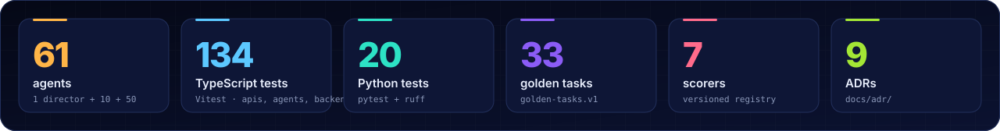
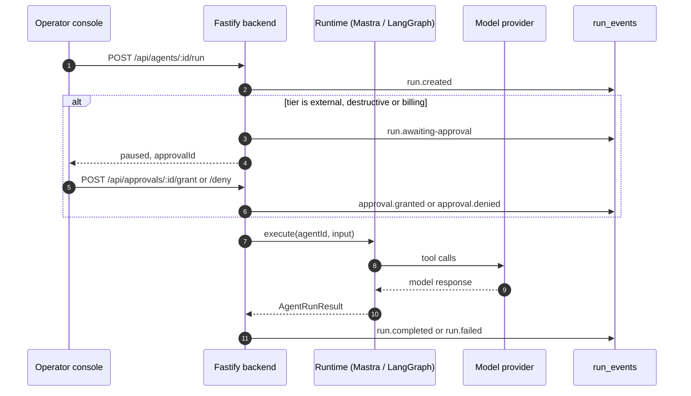
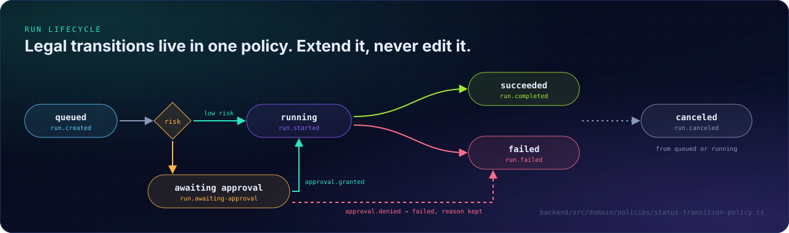
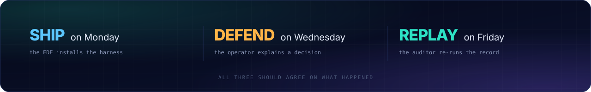

<p align="center">
  
</p>

<p align="center">
  <a href="https://github.com/Alexi5000/TechTideAI2/actions/workflows/ci.yml"></a>
  <a href="https://github.com/Alexi5000/TechTideAI2/tree/v0.5.5"></a>
  <a href="LICENSE"></a>
  
  
</p>

<p align="center">
  <a href="#quick-start"><b>Quick start</b></a> ·
  <a href="#the-org-chart">Org chart</a> ·
  <a href="#one-request-end-to-end">Request flow</a> ·
  <a href="#evals">Evals</a> ·
  <a href="#what-works-today">What works today</a> ·
  <a href="#verify-it-yourself">Verify</a> ·
  <a href="#contributing">Contributing</a>
</p>

<p align="center">
  
</p>

## What TechTideAI is

TechTideAI is a typed, observable and testable harness for running a team of AI agents inside a real business. A forward-deployed engineer (FDE) installs it, the customer's operators run it every day, and an auditor can replay any decision it made.

Three things make that possible:

- **A human approval gate.** Actions tagged `external`, `destructive` or `billing` stop and wait for an operator. The decision is written down with the policy version that was in force.
- **An append-only ledger.** Every state change becomes a `run_events` row, with OpenTelemetry spans alongside, so "what happened?" is one query.
- **Evals that gate regressions.** A 33-task golden suite, 7 versioned scorers and a 5% regression threshold decide whether a change is safe.

The agent team is organized like a company and named like a galaxy: one **Local Group Director**, ten **galaxy orchestrators** that each own a business function, and fifty **star-cluster workers** that do the tool calls.

## Quick start

Requires Node `^22.13.0 || >=24`, pnpm 9, and Python 3.11+ for the optional sidecar.

```bash
git clone https://github.com/Alexi5000/TechTideAI2.git
cd TechTideAI2
pnpm install

cp backend/.env.example        backend/.env
cp frontend/.env.example       frontend/.env
cp agents/.env.example         agents/.env
cp agents/python/.env.example  agents/python/.env

pnpm run dev:backend    # Fastify API on http://localhost:4050
pnpm run dev:frontend   # operator console on http://localhost:5180
pnpm run dev:agents     # Mastra dev console
```

The stack boots without keys. Live agent runs and evals need `OPENAI_API_KEY` or `ANTHROPIC_API_KEY` in `backend/.env` and `agents/.env`.

<details>
<summary><b>Optional: the Python LangGraph sidecar</b></summary>

```bash
cd agents/python
python -m pip install -e ".[dev,server]"
uvicorn techtide_agents.server:app --host 0.0.0.0 --port 4051
```

Then set `LANGGRAPH_SIDECAR_URL=http://localhost:4051` in `backend/.env`.

</details>

<details>
<summary><b>Optional: the whole stack in containers</b></summary>

```bash
docker compose up --build
```

Brings up Postgres, Weaviate, the backend, the frontend and the Python sidecar. See [ADR 0009](docs/adr/0009-containerization.md) for why there is deliberately no production compose file.

</details>

Windows setup, step by step: [docs/DEV_SETUP.md](docs/DEV_SETUP.md).

## The org chart

<p align="center">
  
</p>

The shape is a rule, not a picture. `agents/src/core/registry.test.ts` asserts `1 + 10 + 50 = 61`, so adding a worker without a sibling, or an orchestrator without a runtime-config entry, fails the build.

A flat team of 50 agents can talk to each other O(n²) ways, and every one of those paths can fail or cost money. The pyramid keeps coordination shallow: the director talks to ten leads, each lead talks to five workers.

<details>
<summary><b>Full roster: ids and domains</b></summary>

| Orchestrator | Domain | Workers |
|---|---|---|
| `orch-andromeda` | Product + GTM | `m32`, `m110`, `ngc-205`, `ngc-221`, `pa-1` |
| `orch-milky-way` | Finance + Analytics | `sgr-a`, `orion`, `pleiades`, `cygnus-x1`, `vela` |
| `orch-triangulum` | Sales | `ngc-588`, `ngc-592`, `ngc-595`, `ngc-598`, `ic-133` |
| `orch-centaurus-a` | Engineering | `cena`, `cenb`, `pscen`, `mol001`, `mol002` |
| `orch-m87` | Compliance | `m87-jet`, `m87-stellar`, `m87-globular`, `m87-halo`, `m87-cusp` |
| `orch-whirlpool` | Marketing | `m51a`, `m51b`, `ngc-5195`, `ic-4277`, `ic-4278` |
| `orch-sombrero` | Customer Success | `m104-halo`, `m104-disk`, `m104-bulge`, `m104-globular`, `m104-hii` |
| `orch-pinwheel` | HR + People Ops | `ngc-5447`, `ngc-5455`, `ngc-5461`, `ngc-5462`, `hii-101` |
| `orch-cartwheel` | Content + Docs | `wheel-ring`, `wheel-spoke`, `wheel-core`, `wheel-companion`, `wheel-tail` |
| `orch-circinus` | CS Triage | `eso-97-g13`, `circinus-x1`, `circinus-hii`, `circinus-circumnuclear`, `circinus-dust` |

Worker ids carry a `worker-` prefix in code (for example `worker-m32`). The director's id is `ceo`.

</details>

## One request, end to end

<p align="center">
  
</p>

1. The operator console (`frontend/`, React + Vite) calls the Fastify API (`backend/`, Zod-validated routes).
2. The backend creates the run and classifies its risk before anything executes.
3. Low-risk runs go straight to the runtime: Mastra in TypeScript, or the LangGraph sidecar in Python.
4. Runs in a gated tier wait for an operator. A grant resumes the original input; a denial fails the run and keeps the reason.
5. Providers sit behind one typed `LLMProvider` contract in `apis/` (OpenAI Responses API, Anthropic Messages API).

<details>
<summary><b>The same flow as a sequence diagram</b></summary>



</details>

## Four planes

<p align="center">
  
</p>

| Plane | Owns | Read |
|---|---|---|
| **Product** | Operator console: agents, runs, evals, approvals, sprints | `frontend/src/pages/` |
| **Control** | Director, orchestrators, dispatch, risk classification | `agents/src/core/registry.ts`, [ADR 0003](docs/adr/0003-dual-runtime.md) |
| **Execution** | Workers, tool calls, Mastra and LangGraph runtimes | `agents/src/mastra/`, `agents/python/`, [ADR 0007](docs/adr/0007-skills-vs-tools.md) |
| **Evidence** | `run_events`, traces, evals, post-mortems | `backend/src/services/trace-service.ts`, [ADR 0005](docs/adr/0005-trace-and-memory.md) |

## Run lifecycle

<p align="center">
  
</p>

`StatusTransitionPolicy` in `backend/src/domain/policies/status-transition-policy.ts` is the only place legal transitions are defined. To add one, build a new policy with `extend()`; the default rules are never edited in place.

## Evals

<p align="center">
  
</p>

There are two loops.

- **The golden suite** (`evals/fixtures/golden-tasks.v1.json`) holds 33 tasks covering the director and all ten orchestrators. Each run is scored by the versioned registry in `backend/src/services/scoring/` and compared with a frozen baseline. A drop of 5% or more raises `EvalRegressionDetectedError` and writes a post-mortem to `docs/EVALS/post-mortems/`.
- **The sprint harness** (`backend/src/services/three-agent-harness.ts`) runs a generator, an evaluator and an optional judge until the score converges. A rolling-delta plateau detector stops it as `succeeded`, `plateau`, `max-iterations` or `errored`.

> **Eval status today.** The committed `docs/EVALS/latest.json` is a keyless smoke run. It shows the harness executing all 33 tasks end to end, and every task fails with a missing `OPENAI_API_KEY`, so it says nothing about model quality yet. The scheduled `evals` workflow is switched off because no provider key is funded for CI. To get a real baseline, run the suite locally with your own key:
>
> ```bash
> pnpm -C backend evals --suite golden-tasks.v1 --write-docs
> ```

Targets the suite is built to track:

| Metric | Target | Measured by |
|---|---|---|
| Golden-suite pass rate | ≥ 80% | `pnpm -C backend evals --suite golden-tasks.v1` |
| Orchestrator p95 latency | < 8 s | per-task `latencyMs` on `GET /api/evals/runs/:id` |
| Sprint convergence | ≥ 70% reach `succeeded` or `plateau` within 3 iterations | `pnpm -C backend sprint --contract <file>` |
| Approval time-to-decision | median < 4 h | `GET /api/approvals` |
| Cost per suite run | < $1 | `EvalRunSummary.totalCostUsd` |
| Unrecorded scorer changes | 0 | `EvalRun.scorerVersions` vs. the previous run |

## One contract, two runtimes

<p align="center">
  
</p>

`contracts/schema.json` is the single source of truth. `pnpm exec tsx scripts/sync-contracts.ts` regenerates `agents/src/runtime/contract-types.generated.ts` and `agents/python/src/techtide_agents/contracts/generated.py` and stamps the same FNV-1a hash (currently `a7e92f6b`) on both. `test_contract_sync.py` fails if either side is edited by hand.

## What works today

Every row points at code you can open and a command you can run.

| Surface | Code | Check it |
|---|---|---|
| 61-agent registry | `agents/src/core/registry.ts` | `pnpm -C agents test` |
| Mastra runtime (TypeScript) | `agents/src/mastra/`, `agents/src/runtime/mastra-runtime.ts` | `pnpm -C backend dev`, then `POST /api/agents/:id/run` |
| LangGraph runtime (Python) | `agents/python/src/techtide_agents/runtime/` | `uvicorn techtide_agents.server:app --port 4051` |
| Skills vs. tools | `agents/src/skills/`, [ADR 0007](docs/adr/0007-skills-vs-tools.md) | `prompt-iteration`, `tool-evaluator`, `contract-aware` load into every agent prompt |
| Approval gate | `backend/src/services/approval-service.ts` | submit a `billing` action, see it wait in `/dashboard/approvals` |
| Run ledger + traces | `backend/src/services/trace-service.ts` | `GET /api/runs/:id/trace` |
| Eval harness + 7 scorers | `backend/src/services/eval-harness.ts`, `backend/src/services/scoring/` | `pnpm -C backend evals --suite golden-tasks.v1` |
| Three-agent sprint harness | `backend/src/services/three-agent-harness.ts` | `pnpm -C backend sprint --contract evals/sprints/well-scoped-sprint.v1.json` |
| Post-mortems | `backend/src/services/post-mortem-service.ts` | written to `docs/EVALS/post-mortems/<run-id>.md` |
| Mastra memory | `agents/src/mastra/memory.ts`, `database/supabase/migrations/0005_mastra_memory.sql` | set `SUPABASE_URL` in `agents/.env` |
| Notebook authoring | `notebooks/` (3 notebooks, each with a reviewable `.py` twin) | open in Jupyter, or read the `.py` |
| Contract sync | `contracts/schema.json`, `scripts/sync-contracts.ts` | `pytest agents/python/tests/test_contract_sync.py` |
| Containers | `Dockerfile.{backend,frontend,agents,python}`, `docker-compose.yml` | `docker compose up --build` |

## Verify it yourself

`pnpm run verify` is the merge gate: lint, test and build across every TypeScript workspace.

```bash
pnpm run verify                              # 134 TS tests: apis 2, agents 14, backend 118
pnpm exec tsx scripts/sync-contracts.ts      # no diff means TS and Python agree

cd agents/python
python -m pip install -e ".[dev,server]"
python -m pytest                             # 20 tests
python -m ruff check . && python -m ruff format --check .
```

The full review standard is in [docs/QUALITY_GATES.md](docs/QUALITY_GATES.md).

## Stack

| Layer | Technology |
|---|---|
| Console | React, Vite, Tailwind v4, React Router |
| API | Fastify 5, TypeScript, Zod |
| Agents (TS) | Mastra, typed tools, `@techtide/apis` provider adapters |
| Agents (Python) | LangGraph, LangChain, Pydantic v2, FastAPI sidecar |
| Models | OpenAI Responses API, Anthropic Messages API |
| Data | Supabase (Postgres, Auth, row-level security), Weaviate |
| Observability | OpenTelemetry (in-process or OTLP), `run_events` |
| Quality | pnpm workspaces, Vitest, pytest, ruff, ESLint, CodeQL |

## Repository map

| Path | What lives there |
|---|---|
| `frontend/` | Operator console: agents, runs, evals, approvals, sprints |
| `backend/` | Fastify API, domain policies, services, eval harness, scorers, sprint harness, traces, post-mortems |
| `agents/` | Agent registry, Mastra runtime, tools, skills, memory, generated contract types |
| `agents/python/` | LangGraph runtime, dispatcher, Pydantic contracts, FastAPI sidecar |
| `apis/` | OpenAI and Anthropic provider adapters |
| `contracts/` | The shared TS ↔ Python schema |
| `evals/` | Golden task fixtures and sprint contracts |
| `notebooks/` | Eval authoring notebooks with `.py` twins |
| `database/` | Supabase migrations, Weaviate compose |
| `docs/` | Architecture, setup, quality gates, eval method, ADRs, posts |
| `scripts/` | Contract sync, notebook conversion, stack smoke test |
| `assets/` | README and docs graphics |

## Decisions and writing

Nine ADRs record the load-bearing choices, in reading order:

[0001 Status machine](docs/adr/0001-status-machine.md) ·
[0002 Eval is the product](docs/adr/0002-eval-as-product.md) ·
[0003 Dual runtime](docs/adr/0003-dual-runtime.md) ·
[0004 Approval as execution boundary](docs/adr/0004-approval-as-execution-boundary.md) ·
[0005 Trace and memory](docs/adr/0005-trace-and-memory.md) ·
[0006 Three-agent harness](docs/adr/0006-three-agent-harness.md) ·
[0007 Skills vs. tools](docs/adr/0007-skills-vs-tools.md) ·
[0008 Notebooks as authoring surfaces](docs/adr/0008-notebook-authoring-surface.md) ·
[0009 Containers, no production stack](docs/adr/0009-containerization.md)

Engineering posts: [Lessons from building a company-scale agent OS](docs/posts/lessons-from-building-a-company-scale-agent-os.md) · [The three-agent harness](docs/posts/three-agent-harness.md)

Release notes: [`RELEASE_NOTES_0.5.5.md`](RELEASE_NOTES_0.5.5.md) · history: [`CHANGELOG.md`](CHANGELOG.md) · 15-minute demo script: [`DEMO_WALKTHROUGH.md`](DEMO_WALKTHROUGH.md)

## Roadmap

Not on a fixed timeline. Roughly in order:

1. **A real eval baseline** from a keyed run, replacing the keyless smoke file.
2. **Sprint contracts per orchestrator.** Today there is one example, `evals/sprints/well-scoped-sprint.v1.json`.
3. **Retrieval-grounded scoring.** Wire Weaviate into `rubric-weighted` so answers are checked against real corpus content.
4. **Audit replay UI** at `/dashboard/audit/<run_id>`, walking an auditor through every transition.
5. **Notebook-gated fixtures.** Eval fixture changes require a matching notebook diff.

Open upgrade work is tracked in issues, for example [#93](https://github.com/Alexi5000/TechTideAI2/issues/93) (TypeScript 7) and [#94](https://github.com/Alexi5000/TechTideAI2/issues/94) (AI SDK).

## Contributing

Pull requests are welcome. Read [CONTRIBUTING.md](CONTRIBUTING.md) first; the short version:

1. Branch from `main` and use a Conventional Commits scope (`feat(agents):`, `fix(backend):`, `docs:`).
2. Match the surrounding code's idioms and naming.
3. `pnpm run verify` and the Python checks must pass.
4. New types go in `backend/src/domain/entities/`, new rules in `backend/src/domain/policies/` via `extend()`, new scorers register with `ScorerRegistry`, new golden tasks follow `evals/fixtures/README.md`.

Issue templates live in [`.github/ISSUE_TEMPLATE/`](.github/ISSUE_TEMPLATE/). Security reports: [SECURITY.md](SECURITY.md). Maintained by [@Alexi5000](https://github.com/Alexi5000).

## Acknowledgments

Built on the work of the **Mastra**, **LangGraph** and **LangChain**, **Fastify**, **Pydantic**, **Zod**, **FastAPI**, **Supabase** and **Weaviate** maintainers, and on patterns shared openly by the **Anthropic** and **OpenAI** communities.

## License

[MIT](LICENSE)

<p align="center">
  
</p>
